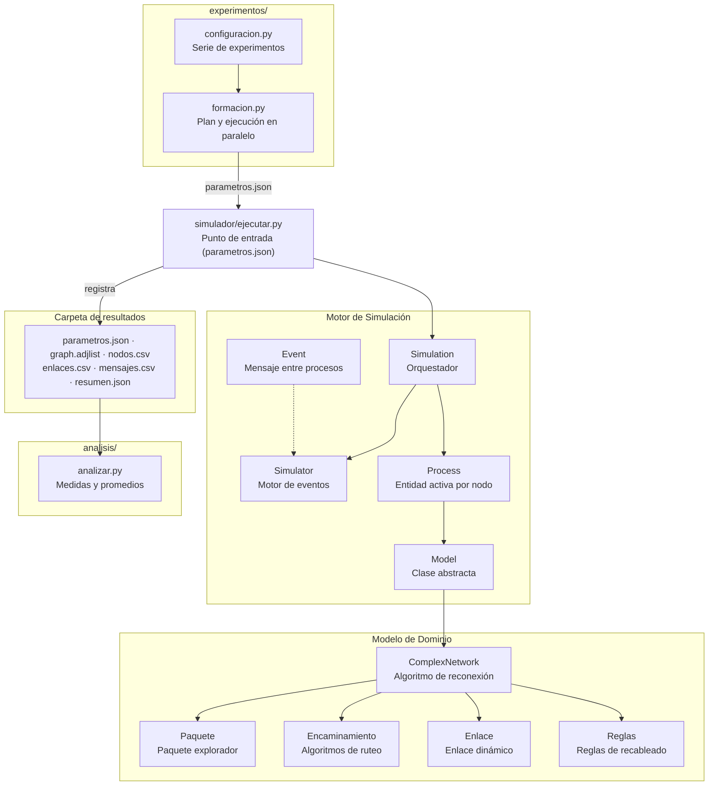
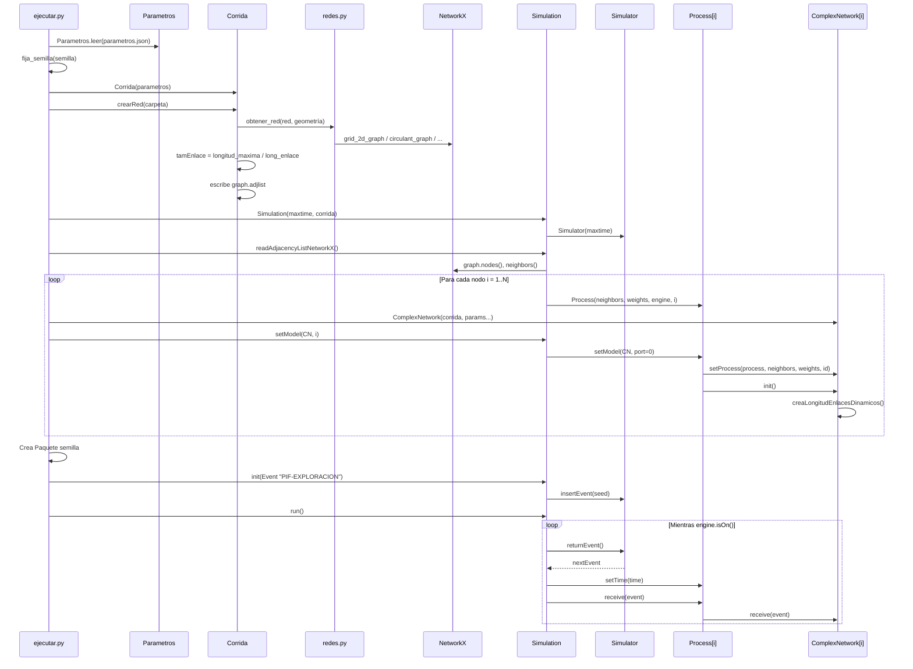
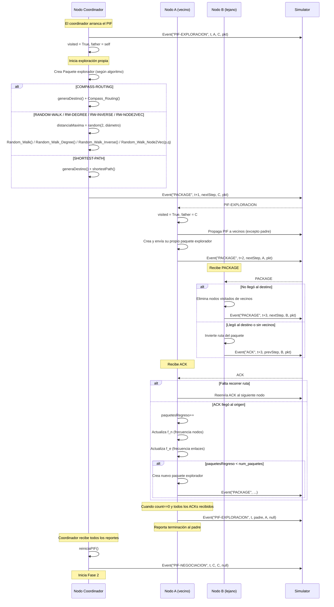
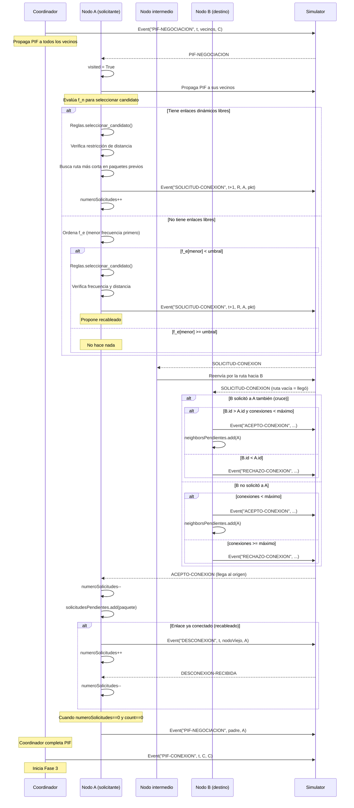
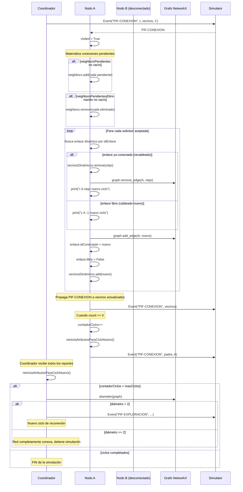
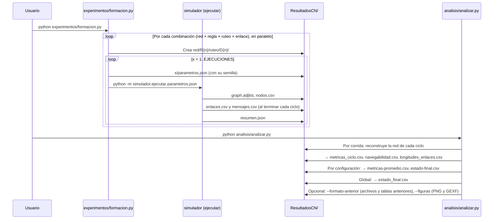

# Rewiring: Simulador de Reconexión Distribuida en Redes Complejas

Simulador de eventos discretos para **modelos de reconexión distribuida en redes complejas**, desarrollado en el marco del proyecto de Ciencia de Frontera **"Modelos de reconexión para la autoorganización de redes complejas de gran escala" (CBF-2025-G-1812)**, apoyado por la Secretaría de Ciencia, Humanidades, Tecnología e Innovación (SECIHTI).

---

## I. Instalación

1. Crear un ambiente de Python (se recomienda Anaconda).
2. Clonar el repositorio:
   ```bash
   git clone https://github.com/netscience/rewiring.git
   cd rewiring
   ```
3. Instalar dependencias:
   ```bash
   pip install -r requirements.txt
   ```

### Dependencias
- `networkx` — creación y análisis de grafos
- `numpy` — cálculos estadísticos (promedios, intervalos de confianza, selección probabilística)
- `scipy` — distancias y componentes en el análisis (rápido también para redes de miles de nodos)
- `matplotlib` — generación de imágenes PNG

### Organización del repositorio

El simulador y el análisis están separados; solo se comunican por la carpeta de resultados.

| Carpeta | Contenido |
|---|---|
| `simulador/` | Motor de eventos y modelo de reconexión. Corre una simulación descrita por un `parametros.json` y registra la red base, la red de cada ciclo y los mensajes. No lee `configuracion.py` ni calcula medidas |
| `experimentos/` | `configuracion.py` (la serie de experimentos) y `formacion.py`, que crea las carpetas, escribe un `parametros.json` por corrida y corre el simulador en paralelo |
| `analisis/` | Lee la carpeta de resultados, reconstruye la red de cada ciclo y calcula todas las medidas y sus promedios; opcionalmente, los archivos y tablas anteriores y las figuras y GEXF de corridas elegidas. No importa el simulador |
| `tests/` | Pruebas unitarias, de regresión del simulador y de extremo a extremo |
| `obsoleto/` | Scripts anteriores (`extractData.py`, `1crea`–`5crea`, `main.py`, ...), solo como referencia |

### Configuración de rutas

Modificar `experimentos/configuracion.py` para indicar la ruta de la carpeta de resultados:

```python
BASE_DIR = str(home_path) + "/Documents/Repositorios/ResultadosCN/"
RESULTADOS_DIR = BASE_DIR + "Formacion"
```

Se recomienda crear un directorio exclusivo para los resultados considerando la ruta relativa al home del usuario.

---

## II. Experimentos de formación de redes

### Configuración de parámetros

Todos los parámetros de una serie de experimentos se definen en `experimentos/configuracion.py`:

| Parámetro | Variable | Valores por defecto | Descripción |
|-----------|----------|-------------------|-------------|
| Topología inicial | `RED` | `["malla", "anillo"]` | Malla 2D o anillo circulante |
| Orden de la topología | `ROWS`, `COLUMNS`, `NODOS_ANILLO` | 8×8, 64 | Número de nodos |
| Regla de reconexión | `REGLAS` | `[1, 2, 3, 4]` | R1, R2, R3, R4 |
| Umbral de uso del enlace | `UMBRAL_ENLACE` | `[1]` | Un nodo sin enlaces libres reconecta su enlace menos usado solo si sus usos en el ciclo son menores que `UMBRAL_ENLACE × EXPLORADORES` (ver [Umbrales de reconexión](#umbrales-de-reconexión)) |
| Umbral de visitas de R1 | `UMBRAL_R1` | `[0.5]` | Al reconectar, R1 solo acepta al nodo más visitado si sus visitas en `f_n` son al menos `UMBRAL_R1 × EXPLORADORES` (ver [Umbrales de reconexión](#umbrales-de-reconexión)) |
| Algoritmo de ruteo | `ROUTING` | `["SHORTEST-PATH", "COMPASS-ROUTING", "RANDOM-WALK", "RW-DEGREE", "RW-INVERSE", "RW-NODE2VEC"]` | SP, CR, RW, RWD, RWI o N2V |
| Parámetros node2vec | `PQ_NODE2VEC` | lista de tuplas `(p, q)` | Pares de parámetros de retorno (`p`) y exploración (`q`) para `RW-NODE2VEC` |
| Longitud de enlace | `LONG_ENLACES` | `[1, 2, 4]` | Divisores de la longitud máxima (D, D/2, D/4) |
| Ciclos de reconexión | `CICLOS` | `5` | Número de ciclos por simulación |
| Ejecuciones | `EJECUCIONES` | `4` | Repeticiones por configuración |
| Enlaces dinámicos | `ENLACES_DINAMICOS` | `2` | Enlaces dinámicos por nodo |
| Exploradores | `EXPLORADORES` | `6` | Paquetes exploradores por nodo y ciclo |
| Máx. conexiones | `DIV_CONEXIONES` | `1` | Divisor del máximo de conexiones (nodos/DIV) |
| Workers en paralelo | `NUM_WORKERS` | `4` | Número de procesos paralelos para ejecutar simulaciones |

### Paralelismo y Selección de Workers

El simulador ejecuta las configuraciones independientes de forma paralela para acelerar sustancialmente el tiempo total de procesamiento. El grado de paralelismo se controla con el parámetro `NUM_WORKERS` en `experimentos/configuracion.py`. El análisis usa el mismo valor por omisión.

#### 1. Cómo identificar el número de núcleos (cores) en tu equipo

Para saber cuántos núcleos lógicos tiene tu procesador, puedes ejecutar el siguiente comando según tu sistema operativo:

* **macOS**:
  Abre la Terminal y ejecuta:
  ```bash
  sysctl -n hw.ncpu
  ```
* **Linux**:
  Abre la Terminal y ejecuta:
  ```bash
  nproc
  # o alternativamente:
  lscpu | grep "^CPU(s):"
  ```
* **Windows**:
  Abre PowerShell y ejecuta:
  ```powershell
  (Get-WmiObject Win32_ComputerSystem).NumberOfLogicalProcessors
  ```
  *(También se puede ver abriendo el **Administrador de Tareas** -> pestaña **Rendimiento** -> sección **CPU** -> **Procesadores lógicos**).*

#### 2. Criterios para configurar `NUM_WORKERS`

* **Rendimiento Máximo:** Configura `NUM_WORKERS` como `N - 1` o `N - 2` (donde `N` es la cantidad de procesadores lógicos). Por ejemplo, si tienes 10 núcleos, selecciona `8` o `9` workers. Esto evitará que la computadora se congele y te permitirá seguir usándola con fluidez para navegar o editar código.
* **Trabajo de Fondo:** Si requieres usar otros programas pesados en paralelo, utiliza `N / 2` o `2 * N / 3` (ej. 6 workers en un procesador de 10 núcleos).
* **RAM y Escala de Red:** Cada worker mantiene en memoria las estructuras y caminos mínimos de NetworkX. Si trabajas con redes grandes (ej. 2500 nodos o más), supervisa el Monitor de Actividad o el Administrador de Tareas para verificar que el uso acumulado de memoria RAM no supere el límite físico de tu equipo.

### Ejecución

Dos pasos, desde la raíz del repositorio:

```bash
python experimentos/formacion.py     # 1. simulaciones (solo registran redes y mensajes)
python analisis/analizar.py          # 2. análisis de RESULTADOS_DIR
```

`formacion.py` revisa `RED`, `ROUTING` y `REGLAS` antes de empezar y se detiene si hay un valor desconocido. Para cada combinación de parámetros y cada ejecución crea la carpeta, escribe `parametros.json` (con su semilla) y corre `python -m simulador.ejecutar parametros.json`.

`analizar.py` acepta otra carpeta de resultados como argumento y estas opciones:

| Opción | Efecto |
|---|---|
| `--pares N` | Pares para la navegabilidad (2000 por omisión) |
| `--workers N` | Procesos en paralelo (por omisión, `NUM_WORKERS`) |
| `--formato-anterior` | Además, los archivos de los scripts anteriores: `datos-salida_x.txt`, `hist_test_*.txt` y `graph_test_*.adjlist` por corrida, `datos-promedio*.csv` por configuración y las tablas `Medidas_estructurales/` (una columna por longitud de enlace). Para comparar con trabajos anteriores de malla y anillo |
| `--figuras RUTA ...` | PNG de la red final y de su distribución de grados, y GEXF para Gephi, solo de las corridas bajo esas rutas (relativas a la carpeta de resultados), p.e. `--figuras malla8x8/R1/RW/D1/1` |
| `--escala-nodos X` | Tamaño de los nodos en las imágenes (por omisión se ajusta al tamaño de la red) |

Se puede volver a correr cuantas veces se quiera sin repetir las simulaciones, y también analiza resultados del formato anterior (con `salida_<n>.txt` y `config.py`).

**Una corrida suelta.** `python -m simulador.ejecutar parametros.json [carpeta]` corre una simulación descrita por un `parametros.json` (campos en `simulador/parametros.py`). El archivo trae la semilla, así que repite exactamente la corrida. Desde Python: `simulador.ejecutar.simular(parametros, carpeta)`.

### Estructura de resultados

```
ResultadosCN/Formacion/
├── malla8x8/
│   ├── R1/
│   │   ├── CR/
│   │   │   ├── D1/
│   │   │   │   ├── 1/ ... n/                ← ejecuciones
│   │   │   │   │   │   (simulador)
│   │   │   │   │   ├── parametros.json      ← todos los parámetros, incluida la semilla
│   │   │   │   │   ├── graph.adjlist        ← red base (ciclo 0)
│   │   │   │   │   ├── nodos.csv            ← coordenadas de cada nodo
│   │   │   │   │   ├── enlaces.csv          ← enlaces dinámicos al terminar cada ciclo
│   │   │   │   │   ├── mensajes.csv         ← mensajes por ciclo y tipo
│   │   │   │   │   ├── resumen.json         ← ciclos completados, motivo de fin, tiempo, semilla
│   │   │   │   │   │   (análisis)
│   │   │   │   │   ├── metricas_ciclo.csv   ← todas las medidas, una fila por ciclo
│   │   │   │   │   ├── navegabilidad.csv    ← greedy en la red base y en la red final
│   │   │   │   │   └── longitudes_enlaces.csv
│   │   │   │   ├── metricas-promedio.csv    ← media e IC 95 % por ciclo
│   │   │   │   └── estado-final.csv         ← estado final de cada ejecución
│   │   │   └── D2/ ...
│   │   ├── RW/ RWD/ RWI/ SP/ ...
│   │   └── N2Vp0_5q2/ ...            ← una carpeta por cada par (p,q) de Node2Vec
│   └── R2/ ...
├── anillo64/ ...
└── estado_final.csv                  ← una fila por configuración
```

Con `--formato-anterior` se agregan además los archivos de los scripts anteriores, y con `--figuras` los PNG y GEXF de las corridas elegidas (ver la tabla de opciones).

**Carpeta de la regla y umbrales.** La carpeta `R<regla>` lleva un sufijo por cada umbral que no tenga su valor por omisión, para que cada valor quede en su propia carpeta: `u<valor>` para `UMBRAL_R1` (solo en R1) y `e<valor>` para `UMBRAL_ENLACE`, con el punto decimal escrito como `_`. Por ejemplo, con `UMBRAL_R1 = [0.5, 0.25]` y `UMBRAL_ENLACE = [1, 0.5]` se generan `R1`, `R1e0_5`, `R1u0_25` y `R1u0_25e0_5`, y para R3, `R3` y `R3e0_5`. Con los valores por omisión las carpetas son las de siempre (`R1`, `R2`, ...), así que los resultados anteriores y sus semillas siguen siendo comparables. Los valores exactos de cada corrida quedan en su `parametros.json` y en las columnas `umbral_r1` y `umbral_enlace` de `estado_final.csv`.

La red del ciclo c es la red base más los enlaces de `enlaces.csv` con `ciclo = c`. Cada fila dice qué enlace (`enlace`) de qué nodo (`nodo`) está conectado con quién (`conectado`), así que se conserva quién es dueño de cada enlace.

### Medidas del análisis

Por ciclo (`metricas_ciclo.csv`; promedios con intervalo de confianza al 95 % en `metricas-promedio.csv`):

| Grupo | Columnas |
|---|---|
| Estructura | `agrupamiento`, `aspl`, `diametro`, `componentes`, `frac_gigante` (fracción de nodos en la componente gigante), `asortatividad` |
| Grados | `grado_medio`, `grado_max`, `cv_grado` (coeficiente de variación), `gini_grado` (índice de Gini; 0 en una red regular, (n−2)/(2n) ≈ 0.5 en una estrella) |
| Enlaces dinámicos | `enlaces_dinamicos`, `longitud_media` (número de saltos entre sus extremos en la red base) |
| Convergencia | `ks_grado` (Kolmogorov-Smirnov con la distribución de grados del ciclo anterior), `frac_cambio` (fracción de enlaces dinámicos que cambió) |
| Costo | `mensajes` (total del ciclo), `mensajes_exploracion` (PACKAGE + ACK) |

`componentes` y `frac_gigante` valen 1 en todas las corridas: la reconexión solo quita y pone enlaces dinámicos y nunca toca las aristas de la red base, así que la red siempre es conexa. Se conservan como verificación del simulador.

Además, por corrida:

- `navegabilidad.csv`: ruteo greedy guiado por la distancia en saltos de la red base (desde cada nodo se avanza al vecino más cercano al destino según esa distancia), sobre `--pares` pares al azar, en la red base y en la red final: éxito, pasos medios y estiramiento (pasos / distancia más corta).
- `longitudes_enlaces.csv`: distribución de longitudes (en saltos de la red base) de los enlaces dinámicos de la red final, junto al número medio de nodos a esa distancia de un nodo cualquiera, para comparar la distribución observada con la que daría una elección al azar.

El estado final (`estado-final.csv` por configuración y `estado_final.csv` global) es el promedio de los últimos 5 ciclos de cada medida, más la navegabilidad de la red final. Si una ejecución terminó antes porque el diámetro llegó a 2, sus últimos valores se repiten hasta completar los ciclos.

### Mensajes registrados

`mensajes.csv` tiene, para cada ciclo, el número de mensajes procesados de cada tipo: `PIF-EXPLORACION`, `PACKAGE`, `ACK`, `PIF-NEGOCIACION`, `SOLICITUD-CONEXION`, `ACEPTO-CONEXION`, `DESCONEXION`, `DESCONEXION-RECIBIDA`, `RECHAZO-CONEXION` y `PIF-CONEXION`. `resumen.json` trae el total y el tiempo de ejecución.

### Espacio de experimentos

Con la configuración por defecto se generan:

| Dimensión | Valores | Cantidad |
|-----------|---------|----------|
| Topologías | malla50x50 | 1 |
| Reglas | R1, R2, R3 | 3 |
| Ruteo base | RWD, RWI | 2 |
| Ruteo node2vec | N2V × 16 combinaciones (p,q) | 16 |
| Long. enlace | D2, D4, D8, D16, D32 | 5 |
| Ejecuciones | 1–10 | 10 |
| **Total** | **(2 + 16) × 3 × 5 × 10** | **2 700 simulaciones** |

> **Nota:** Para agregar los algoritmos clásicos (`SP`, `CR`, `RW`) simplemente inclúyelos en la lista `ROUTING` de `experimentos/configuracion.py`.

---

## Reproducibilidad y pruebas

**Semillas.** En `experimentos/configuracion.py`, `SEMILLA_BASE = None` deja las corridas aleatorias. Con un entero, cada corrida recibe una semilla propia, distinta y reproducible, derivada de la base, de la ruta de su configuración y de su número de ejecución; queda en `parametros.json` y en `resumen.json`. Una corrida se repite con `python -m simulador.ejecutar <carpeta>/parametros.json <otra_carpeta>`.

**Diámetro 2.** Por omisión la simulación se detiene si el diámetro llega a 2 (`parar_en_diametro_2` en `parametros.json`); `resumen.json` registra en qué ciclo ocurrió y el motivo de fin.

**Pruebas.**

| Archivo | Qué prueba | Tiempo |
|---|---|---|
| `tests/unidades.py` | `redes.py` (topologías, coordenadas, distancias), los ruteos, las reglas R1 a R4, `parametros.py` y medidas del análisis | Segundos |
| `tests/regresion.py` | El simulador: 15 configuraciones pequeñas (malla y anillo, todos los ruteos, R1 a R4, umbrales de reconexión, parada por diámetro 2) con semilla fija; compara `enlaces.csv`, `mensajes.csv` y `resumen.json` con `tests/referencia/` | Segundos |
| `tests/analisis_anterior.py` | El análisis sobre resultados del formato anterior (`salida_<n>.txt`), comparado con lo que producían los scripts anteriores | Menos de 1 min |
| `tests/pipeline.py` | De extremo a extremo: `experimentos/formacion.py` y `analisis/analizar.py` sobre una rejilla pequeña, comparados con `tests/referencia/pipeline.json` | 1 a 3 min |

Después de cualquier cambio:

```bash
python tests/correr_todas.py            # todas
python tests/correr_todas.py --rapidas  # solo unidades y regresión
```

Si un cambio de comportamiento es intencional, se regeneran las referencias con `--actualizar` en la prueba correspondiente.

---

## III. Arquitectura del simulador



### Componentes del simulador

Todos en `simulador/`.

#### Motor de simulación de eventos discretos

| Archivo | Responsabilidad |
|---------|-----------------|
| `simulator.py` | Motor con agenda ordenada por tiempo. Inserta/extrae eventos en orden causal |
| `simulation.py` | Orquesta el experimento: lee el grafo, crea procesos, ejecuta el bucle principal |
| `process.py` | Entidad activa en cada nodo. Asocia modelos y reenvía eventos |
| `model.py` | Clase abstracta base con métodos `init()`, `receive()`, `send()` |
| `event.py` | Encapsula: nombre, tiempo, destino, fuente, paquete, puerto |

#### Modelo de reconexión distribuida

| Archivo | Responsabilidad |
|---------|-----------------|
| `complexNetwork.py` | **Núcleo del simulador**. Implementa las 3 fases del ciclo de reconexión |
| `paquete.py` | Paquete explorador: lleva ruta, destino, distancia máxima, ID de enlace |
| `encaminamiento.py` | Algoritmos de ruteo (la distancia entre nodos la obtiene de `redes.py`) |
| `enlace.py` | Enlace dinámico: ID, longitud máxima, estado libre/ocupado, nodo conectado |
| `reglas.py` | 3 reglas de selección de candidato a reconexión |
| `redes.py` | Tipos de red (malla, anillo): creación del grafo, coordenadas y distancia entre nodos |
| `parametros.py` | Parámetros de una corrida (`parametros.json`) |
| `ejecutar.py` | Corre una simulación a partir de sus parámetros |
| `salida.py` | Escribe los archivos de la corrida (red de cada ciclo, mensajes, resumen) |

---

## IV. Algoritmo de reconexión

Cada ciclo de simulación ejecuta 3 fases coordinadas mediante **PIF (Propagation of Information with Feedback)**:

### Fase 1: Exploración (`PIF-EXPLORACION`)
- Cada nodo envía `N` **paquetes exploradores** a la red
- Los paquetes viajan usando uno de los **6 algoritmos de ruteo** disponibles
- Al regresar (vía `ACK`), se actualizan:
  - `f_n`: frecuencia de visita a nodos no-vecinos
  - `f_e`: frecuencia de uso de enlaces dinámicos

### Fase 2: Negociación (`PIF-NEGOCIACION`)
- Cada nodo selecciona candidatos a conexión usando `f_n` y una regla
- Si tiene enlaces libres → envía `SOLICITUD-CONEXION`
- Si no tiene enlaces libres → evalúa recableado del enlace menos usado (`f_e`), sujeto a los [umbrales de reconexión](#umbrales-de-reconexión)
- Los destinos responden con `ACEPTO-CONEXION` o `RECHAZO-CONEXION`
- Se desempatan solicitudes cruzadas (gana el ID mayor)

### Fase 3: Conexión (`PIF-CONEXION`)
- Se materializan las conexiones/desconexiones aceptadas
- Se actualiza el grafo NetworkX subyacente
- Se registra el estado de los enlaces dinámicos en `enlaces.csv` y los mensajes del ciclo en `mensajes.csv`
- Se reinician atributos para el nuevo ciclo (`f_n` y `f_e` vuelven a cero)

### Umbrales de reconexión

Dos conteos que cada nodo acumula durante la exploración de un ciclo deciden la reconexión:

- **`f_n[v]`**: cuántas veces aparece el nodo `v` en las rutas de los exploradores del nodo. No cuenta al propio nodo, a sus vecinos de la red base ni a los nodos con los que ya está conectado por un enlace dinámico. Si una caminata pasa dos veces por `v`, cuenta dos.
- **`f_e[l]`**: cuántos exploradores del nodo salieron (y regresaron) por su enlace dinámico `l`.

En la negociación, cada nodo hace una de dos cosas:

1. **Si tiene enlaces libres**, los llena con los candidatos que elige la regla en `f_n`, siempre que respeten la longitud máxima del enlace. Aquí no se aplica ningún umbral.
2. **Si no tiene enlaces libres**, considera reconectar **un solo** enlace por ciclo, el que tenga menor `f_e`:
   - **`UMBRAL_ENLACE`** (todas las reglas). El enlace se reconecta solo si `f_e[l] < UMBRAL_ENLACE × EXPLORADORES`. Con 1, el valor por omisión, se reconecta salvo que todos los exploradores del ciclo lo hayan usado. Con 0.5, solo si lo usó menos de la mitad. Con 0 nunca se reconecta: los enlaces se llenan una vez y se quedan fijos.
   - **`UMBRAL_R1`** (solo R1). La regla propone al nodo más visitado de `f_n`, y la reconexión se hace solo si `f_n[candidato] ≥ UMBRAL_R1 × EXPLORADORES`. Con 0.5, el valor por omisión, con 4 exploradores el candidato necesita al menos 2 visitas. Con 0 no hay umbral. Si el candidato no cumple el umbral o la longitud máxima, ese ciclo no se reconecta, porque no se prueba un segundo candidato. R2, R3 y R4 no usan este umbral.

Los dos se expresan como fracción del número de exploradores, así que su efecto no cambia al cambiar `EXPLORADORES`. En `experimentos/configuracion.py` son listas, como los demás factores: cada valor genera sus propias carpetas de resultados (ver [Estructura de resultados](#estructura-de-resultados)). En una corrida suelta se fijan con `umbral_enlace` y `umbral_r1` en `parametros.json`.

### Algoritmos de encaminamiento

| Algoritmo | Clave | Descripción |
|-----------|-------|-------------|
| Compass Routing | `CR` | Reenvía al vecino con menor ángulo hacia el destino |
| Shortest Path | `SP` | Calcula ruta más corta vía Dijkstra (usa visión global) |
| Random Walk | `RW` | Camina aleatoriamente hasta `distanciaMaxima` pasos |
| Random Walk — Degree | `RWD` | Caminata sesgada por grado: P(u) ∝ deg(u). Favorece saltar hacia nodos de alta conectividad (hubs) |
| Random Walk — Inverse Degree | `RWI` | Caminata sesgada por grado inverso: P(u) ∝ 1/deg(u). Favorece nodos periféricos de baja conectividad |
| Random Walk — Node2Vec | `N2V` | Caminata con sesgo de retorno (`p`) y exploración (`q`). `q < 1` favorece DFS (exploración lejana); `q > 1` favorece BFS (exploración local). Configurado mediante `PQ_NODE2VEC` |

> Los algoritmos **RWD**, **RWI** y **N2V** se basan en el análisis comparativo de estrategias de caminata aleatoria presentado en:
>
> Vital Jr., A., Silva, F. N., & Amancio, D. R. (2024). **Comparing random walks in graph embedding and link prediction**. *PLOS ONE*, 19(11), e0312863. https://doi.org/10.1371/journal.pone.0312863

#### Configuración de parámetros node2vec

Cuando `ROUTING` incluye `"RW-NODE2VEC"`, se deben definir las combinaciones de parámetros en `PQ_NODE2VEC`:

```python
# experimentos/configuracion.py
PQ_NODE2VEC = [
    (0.25, 0.25), (0.25, 0.5), (0.25, 1), (0.25, 2),
    (0.5,  0.25), (0.5,  0.5), (0.5,  1), (0.5,  2),
    (1,    0.25), (1,    0.5), (1,    1), (1,    2),
    (2,    0.25), (2,    0.5), (2,    1), (2,    2),
]
```

| Parámetro | Efecto |
|-----------|--------|
| `p < 1` | Incentiva el retorno al nodo anterior (exploración local) |
| `p > 1` | Desincentiva el retorno (evita dar la vuelta) |
| `q < 1` | Favorece exploración hacia nodos lejanos (DFS) |
| `q > 1` | Favorece exploración de la vecindad inmediata (BFS) |

Cada combinación `(p, q)` genera una subdirectorio independiente con la nomenclatura `N2Vp{p}q{q}/D{long}/`.

### Reglas de recableado

| Regla | Selección de candidato |
|-------|----------------------|
| R1 | Nodo más visitado en `f_n` (mayor frecuencia); al reconectar, solo si tiene al menos `UMBRAL_R1 × EXPLORADORES` visitas |
| R2 | Primer nodo en `f_n` (orden de descubrimiento) |
| R3 | Selección probabilística proporcional a la frecuencia en `f_n` |

---

## V. Diagramas de secuencia

### 1. Inicialización del simulador



### 2. Fase de exploración (PIF-EXPLORACION)



### 3. Fase de negociación (PIF-NEGOCIACION)



### 4. Fase de conexión (PIF-CONEXION)



### 5. Pipeline de experimentos



---

## VI. Referencias

### Algoritmos de encaminamiento

- Kranakis, E., Singh, H., & Urrutia, J. (1999). **Compass routing on geometric networks**. In *Proceedings of the 11th Canadian Conference on Computational Geometry (CCCG '99)*, pp. 51–54. Vancouver, BC, Canada. http://www.cccg.ca/proceedings/1999/c46.pdf

  > Artículo original que define el algoritmo **Compass Routing** implementado en la fase de exploración: el paquete siempre avanza hacia el vecino cuya dirección minimiza el ángulo respecto al destino.

- Grover, A., & Leskovec, J. (2016). **node2vec: Scalable feature learning for networks**. In *Proceedings of the 22nd ACM SIGKDD International Conference on Knowledge Discovery and Data Mining (KDD '16)*, pp. 855–864. https://doi.org/10.1145/2939672.2939754 · Preprint: https://arxiv.org/abs/1607.00653

  > Artículo original que define el algoritmo **node2vec**: una caminata aleatoria sesgada por dos parámetros `p` (retorno) y `q` (exploración) que interpola entre búsqueda en anchura (BFS) y en profundidad (DFS). Es la base del algoritmo `RW-NODE2VEC` implementado en la fase de exploración.

- Vital Jr., A., Silva, F. N., & Amancio, D. R. (2024). **Comparing random walks in graph embedding and link prediction**. *PLOS ONE*, 19(11), e0312863. https://doi.org/10.1371/journal.pone.0312863

  > Análisis comparativo de estrategias de caminata aleatoria —incluyendo node2vec, degree-biased e inverse degree-biased— que fundamenta la selección de los algoritmos **RW-DEGREE**, **RW-INVERSE** y **RW-NODE2VEC** implementados en la fase de exploración.

### Publicaciones que utilizan este simulador

- López Chavira, M. A., & Marcelín-Jiménez, R. (2017). **Distributed rewiring model for complex networking: The effect of local rewiring rules on final structural properties**. *PLOS ONE*, 12(11), e0187538. https://doi.org/10.1371/journal.pone.0187538

  > Primera publicación que introduce el modelo distribuido de reconexión implementado en este simulador. Se analizan las reglas de reconexión local (R1, R2, R3) y su efecto en propiedades estructurales globales como el coeficiente de agrupamiento y el diámetro.

- López-Chavira, M. A., Aguirre-Guerrero, D., Marcelín-Jiménez, R., Vásquez-Toledo, L. A., & Bernal-Jaquez, R. (2024). **A distributed geometric rewiring model**. *Scientific Reports*, 14, 11152. https://doi.org/10.1038/s41598-024-61695-y

  > Extensión del modelo que incorpora restricciones geométricas a la reconexión mediante el parámetro de longitud de enlace (`LONG_ENLACE`). Se demuestra que limitar la distancia máxima del enlace dinámico permite obtener topologías con propiedades de mundo pequeño preservando la localidad geográfica.
